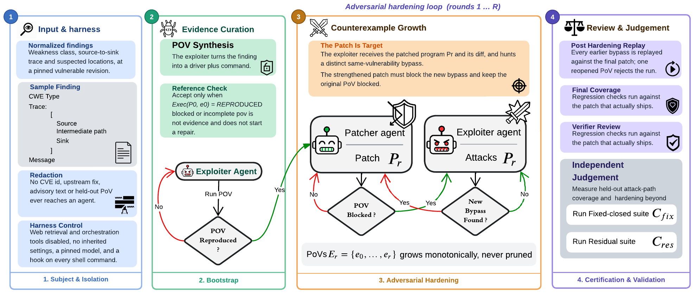
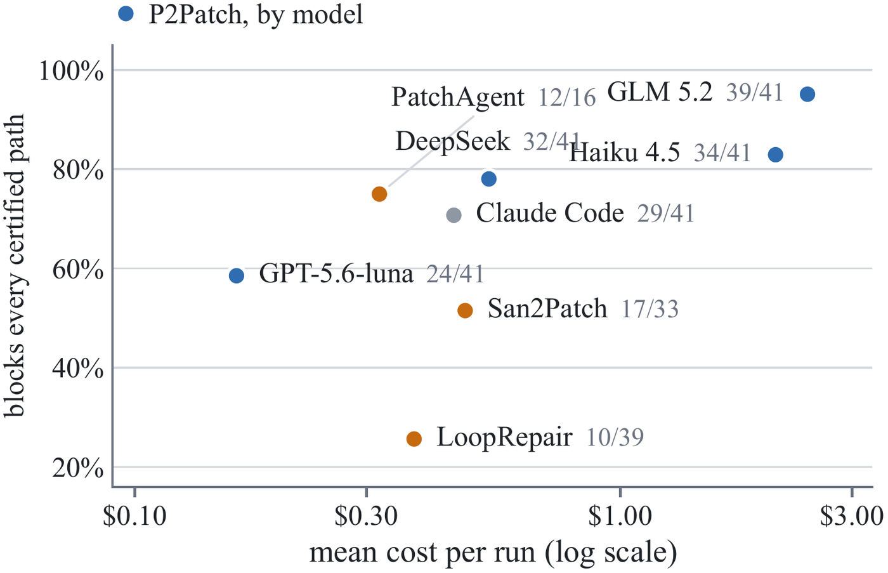
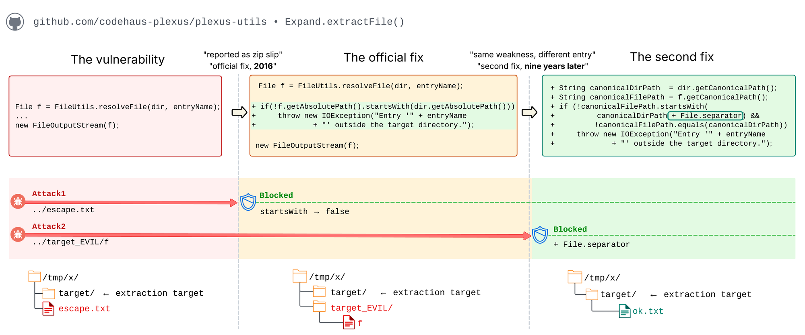

<div align="center">

# P2Patch: Exploit-Guided Vulnerability Repair

**An LLM repair system that treats every patch as a new attack target.**

[](LICENSE)
[](pyproject.toml)
[](benchmark/README.md)

[Usage guide](docs/USAGE.md) ·
[Benchmark](benchmark/README.md) ·
[Citation](#citation)

</div>

---

Automated vulnerability repair usually validates a patch against the same
evidence used to build it: a static alert, a sanitizer trace, a published
exploit, or a test suite. A patch that blocks that one piece of evidence can
look successful while the same vulnerability stays reachable through a
slightly different input, encoding, or entry point.

**P2Patch** closes that loop with an adversary. An *exploiter* agent turns a
vulnerability finding into a working proof of vulnerability (PoV), a *patcher*
agent repairs the program, and the exploiter then attacks the **patched**
program for a new bypass of the same vulnerability. Every bypass that execution
confirms becomes a permanent repair requirement, and the final patch must block
all of them. Patches are then scored against held-out exploit suites that no
agent ever sees.

<p align="center">
  
</p>

## Highlights

- **Exploit-guided repair.** The repair target grows during the run: each
  execution-confirmed bypass of the current patch becomes a new requirement.
- **Execution decides, not the agents.** An orchestrator runs every PoV in the
  project's container and classifies the outcome as *reproduced*, *blocked*, or
  *inconclusive*; agents never certify their own success.
- **Held-out security oracles.** Final patches are scored by curated exploit
  suites that are kept strictly separate from anything used during repair.
- **VulnRepairBench.** 101 real CVEs (60 Java, 41 C/C++) from 61 repositories,
  each pinned to its vulnerable commit and buildable in a container.

## Key results

All results are from the paper, on the 101 VulnRepairBench subjects, with Claude
Haiku 4.5 unless stated otherwise.

- After a patch had already blocked its own PoV, the exploiter found a distinct,
  execution-confirmed bypass in **41%** of runs.
- Compared with single-pass repair from the same finding, P2Patch improves
  held-out coverage on both oracle families:

| Oracle | Subjects | Single pass | **P2Patch** | Δ |
|---|---:|---:|---:|---:|
| Fix-closed coverage (paths the official fix closes) | 101 | 0.781 | **0.847** | +0.065 |
| Beyond-upstream coverage (paths the official fix leaves open) | 40 | 0.421 | **0.625** | +0.204 |

- The improvement holds across model families:

| Model | Accepted repairs | Runs with a bypass | Fix-closed | Beyond-upstream | Mean cost / subject |
|---|---:|---:|---:|---:|---:|
| Claude Haiku 4.5 | 98 / 101 | 41% | 0.847 | 0.625 | $2.09 |
| GLM 5.2 | 100 / 101 | 47% | **0.921** | **0.795** | $2.43 |
| DeepSeek V4 Flash | 94 / 101 | 35% | 0.821 | 0.608 | $0.54 |
| GPT-5.6-luna | 66 / 101 | 31% | 0.594 | 0.400 | $0.16 |

- Under the same held-out suites, P2Patch also covers more certified attack
  paths than published repair systems on their shared subjects:

| Comparison system | Fix-closed: system → P2Patch | Beyond-upstream: system → P2Patch |
|---|---:|---:|
| San2Patch | 0.608 → **0.922** | 0.100 → **0.600** |
| LoopRepair | 0.325 → **0.930** | 0.182 → **0.636** |
| PatchAgent | 0.836 → **0.929** | 0.167 → **0.667** |

<p align="center">
  
</p>

## Why the patch has to be attacked

The example below, from the paper, is a real case in plexus-utils. The
official 2016 fix for a zip-slip path traversal blocked the reported attack,
but an archive entry that lands in a *sibling* directory sharing the target's
name prefix still escaped, because `startsWith` compares characters, not path
components. Upstream closed that gap more than nine years later. Re-running
the original exploit could never have revealed it; attacking the patched
program does.

<p align="center">
  
</p>

## Repository layout

| Path | Contents |
|---|---|
| [`security_pipeline/`](security_pipeline) | The P2Patch orchestrator (pure Python standard library): stages, experiment profiles, Docker runner, gates, evaluation. |
| [`security_pipeline/prompts/`](security_pipeline/prompts) | The exploiter, patcher and verifier prompt templates. |
| [`benchmark/`](benchmark) | **VulnRepairBench**: dataset tables, per-subject Dockerfiles, and the fix-closed and residual PoV suites. |
| [`finder_results_filtered/`](finder_results_filtered) | The normalized vulnerability findings (alerts) the pipeline runs on. |
| [`baselines/`](baselines) | The harness and recorded results for re-scoring San2Patch, LoopRepair and PatchAgent. |
| [`dashboard/`](dashboard) | P2Patch Lab, a web UI for browsing, comparing and launching runs. |
| [`tests/`](tests) | Unit tests for the pipeline, evaluation and dashboard. |
| [`docs/`](docs) | The usage guide and figures. |

## Getting started

Requirements: Python 3.10+, Docker, Git, and the
[Claude Code CLI](https://claude.com/claude-code). Node.js 18+ is needed only
for the dashboard.

```bash
git clone https://github.com/P2Patch/P2patch.git
cd P2patch
python3 -m venv .venv && source .venv/bin/activate
pip install -e .                 # registers the `security-pipeline` command; no third-party deps

security-pipeline fetch                                # clone the benchmark projects' sources
security-pipeline run --cve CVE-2021-29425             # one subject, full exploit -> patch -> verify run
security-pipeline run --all --profile hardening        # the full P2Patch protocol over the benchmark
```

The [usage guide](docs/USAGE.md) covers the experiment profiles
(`baseline`, `full`, `hardening`, and ablations), evaluation commands, model-provider
configuration, and the dashboard. Run the tests with
`python -m unittest discover -s tests`.

## Reproducing the paper

- **Runs.** The 505 pipeline runs behind the paper's numbers, with agent
  transcripts, container logs, patches and verdicts, are too large for this
  repository and are distributed separately. See
  [The paper's pipeline runs](docs/USAGE.md#the-papers-pipeline-runs) for the
  download and how to browse them in the dashboard.
- **Scoring.** `security-pipeline fixpov replay` and `respov replay` re-score
  recorded runs against the held-out suites; `baselines/` re-scores the
  published systems.
- **Benchmark.** [`benchmark/README.md`](benchmark/README.md) documents the
  dataset, the two PoV families and how each suite is certified.

## Responsible release

Building VulnRepairBench uncovered attack paths that some projects' official
CVE fixes leave open, several of which are still present in those projects'
current code. We reported these gaps to the affected projects. Until fixes are
available, the corresponding exploit artifacts are **withheld** from this
repository: 18 of the 40 residual suites and 4 of the 101 fix-closed suites.
[benchmark/WITHHELD_ARTIFACTS.md](benchmark/WITHHELD_ARTIFACTS.md) explains what
is withheld, what can still be reproduced, and how to request access. To report
a security issue, see [SECURITY.md](SECURITY.md).

P2Patch generates and executes exploits. Run it only against code you are
authorized to test, and keep its containers isolated, as the pipeline does by
default.

## Citation

If you use P2Patch or VulnRepairBench, please cite:

```bibtex
@misc{iranmanesh2026p2patch,
  title   = {{P2Patch}: Exploit-Guided Vulnerability Repair},
  author  = {Iranmanesh, Mohsen and Moradi Sabet, Sina and Marefat, Sina and
             Javidi Ghasr, Ali and Newman Nereyabagabo, Maxime and
             Amouzesh, Kousha and Malhi, Jaivir and Velasco, Vinci and
             Chung, Alex and Tayebi, Mohammad A.},
  year    = {2026},
  note    = {Preprint}
}
```

Mohsen Iranmanesh and Sina Moradi Sabet contributed equally.

## License

Released under the [MIT License](LICENSE). Third-party material included in the
benchmark, such as upstream fix patches and project build files, remains under
its original projects' licenses.

## Contact

- Sina Moradi Sabet (maintainer): <sina.moradi4233@gmail.com>
- Mohsen Iranmanesh: <mhsn.iranmanesh@gmail.com>

Questions and issues are welcome on the [issue tracker](https://github.com/P2Patch/P2patch/issues);
please report security issues privately as described in [SECURITY.md](SECURITY.md).
